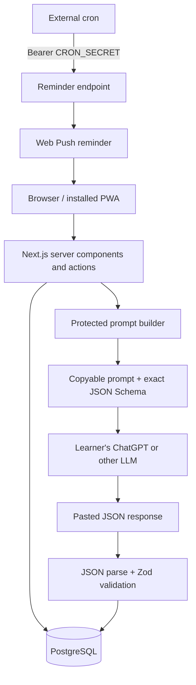

# Daily Smarter

Daily Smarter is a daily micro-learning PWA that works with the learner's own ChatGPT or preferred LLM account. The application builds a curriculum-aware prompt from the selected course, learning history, quiz performance, and experience level. The learner copies that prompt into an LLM, pastes the JSON response back, and the application validates it against a fixed schema before creating the lesson.

There is no shared OpenAI API key, usage bill, or automatic model call.

## Product Flow

1. Select a public course or create your own.
2. Open today's lesson and copy the generated prompt.
3. Send the prompt to ChatGPT or another capable LLM.
4. Paste the returned JSON into Daily Smarter.
5. The server validates and stores the lesson.
6. Read it, answer the server-scored quiz, and build your streak.

The prompt asks for exactly one concept and includes the fixed JSON Schema. Raw JSON and a single `json` Markdown code fence are accepted. Commentary, malformed JSON, missing fields, extra structure, invalid quiz options, and oversized content are rejected before storage.

## Features

- One lesson per learner and local calendar day
- Copyable prompts containing concise learning history, not full lesson contents
- Strict Zod response parsing and a fixed lesson contract
- Public and private user-created courses
- Course creation, editing, deletion, selection, search, and quality filtering
- One 1-5 star rating per user and course
- Server-side quiz scoring without exposing the answer before submission
- Timezone-safe streak reconstruction, history, progress, and statistics
- Argon2id authentication and opaque database-backed sessions
- Opt-in Web Push reminders and an installable offline-capable PWA
- Protected administrator routes and legacy API audit history

## Stack

- Next.js App Router, React, strict TypeScript, Tailwind CSS
- PostgreSQL and Prisma ORM
- Zod for forms and pasted lesson validation
- Web Push with VAPID
- Vitest unit and PostgreSQL integration tests

## Architecture



Course guidance is untrusted prompt content. It is delimited from source-controlled core instructions and cannot change the required structure. Existing lessons remain unchanged when a course is edited or deleted.

## Local Setup

Requirements: Node.js 22+, npm, and Docker or PostgreSQL 15+.

```bash
npm install
cp .env.example .env
docker compose up -d postgres
npm run db:deploy
npm run db:seed
npm run dev
```

Open [http://localhost:3000](http://localhost:3000).

### Development Accounts

The development-only seed creates:

```text
admin@example.com / DevelopmentOnly!123
demo@example.com  / DevelopmentOnly!123
```

`SEED_*` environment variables can override these values. The seed refuses to run with `NODE_ENV=production`.

## Environment

| Variable                       | Purpose                                      |
| ------------------------------ | -------------------------------------------- |
| `DATABASE_URL`                 | PostgreSQL connection string                 |
| `AUTH_SECRET`                  | At least 32 characters; HMACs session tokens |
| `NEXT_PUBLIC_APP_URL`          | Canonical public URL                         |
| `NEXT_PUBLIC_VAPID_PUBLIC_KEY` | Browser-safe public VAPID key                |
| `VAPID_PUBLIC_KEY`             | Server copy of the public VAPID key          |
| `VAPID_PRIVATE_KEY`            | Server-only VAPID private key                |
| `VAPID_SUBJECT`                | Contact URI, normally `mailto:...`           |
| `CRON_SECRET`                  | Bearer secret for the reminder endpoint      |

Generate secrets and VAPID keys with:

```bash
openssl rand -base64 48
npx web-push generate-vapid-keys
```

No LLM API key is required. Users interact with the LLM outside the application using their own accounts.

## Courses

The official low-level computing course is seeded by default. Learners can create a course with controlled fields for domain, description, curriculum guidance, emphasized and avoided topics, difficulty, lesson length, teaching style, and additional guidance.

Public courses appear in the community browser. Private courses are visible only to their creator. Creators can edit or delete their own non-system courses. Administrators can edit user courses, while the official system course cannot be deleted. Database relations use `SET NULL` so deleting a course does not remove historical lessons.

Ratings are constrained to 1-5 in both Zod and PostgreSQL, with one rating per user and course. The browser supports minimum-rating filters and sorting by rating, popularity, or recency.

## Lesson Contract

Every pasted response must contain:

```text
title
topic_key
difficulty
estimated_reading_minutes
introduction
concept
how_it_works
why_it_matters
concrete_example
key_terms: 3-5 term/definition objects
quiz: question, exactly 4 options, correct_option, explanation
prerequisite_topics
related_topics
```

The correct quiz index is stored server-side and omitted from lesson reads before submission. Pasted content is limited to 100 KB and every text field has schema limits.

## Scheduling And Push

Invoke the provider-independent endpoint every 10 to 15 minutes:

```bash
curl -X POST \
  -H "Authorization: Bearer $CRON_SECRET" \
  "$NEXT_PUBLIC_APP_URL/api/internal/run-daily-learning"
```

The worker checks each enabled user's timezone and reminder time. If today's lesson is incomplete, it atomically creates one `ReminderDelivery` record and sends a prompt reminder. Concurrent jobs cannot send duplicate daily reminders.

Push requires HTTPS outside localhost. Permission is requested only after the learner chooses to enable it. Expired subscriptions returning 404 or 410 are removed.

## PWA And Offline Use

The manifest includes 192px and 512px install icons for Android and desktop Chromium browsers. The service worker caches successfully visited pages and provides an offline fallback. Previously opened lessons can be read offline, but lesson imports and quiz submissions require a connection.

## Database

Production migrations:

```bash
npm run db:deploy
```

Development migrations:

```bash
npm run db:migrate
```

Database constraints enforce unique daily lessons, completions, quiz attempts, course ratings, reminder deliveries, push endpoints, and the active legacy configuration version. Ownership, state, date, topic, course, and history queries are indexed.

## First Production Admin

Register normally, then run in a trusted deployment shell:

```bash
npm run admin:promote -- you@example.com
```

All administrator pages and actions verify the role server-side.

## Verification

```bash
npm run format:check
npm run lint
npm run typecheck
npm test
npm run build
```

Set `TEST_DATABASE_URL` to an already-migrated PostgreSQL database to enable integration tests. CI starts PostgreSQL, applies migrations, and runs formatting, linting, type checking, tests, and a production build.

## Production Deployment

1. Provision PostgreSQL with backups and transport security.
2. Configure environment values in the host's secret store.
3. Run `npm ci`, `npm run db:deploy`, and `npm run build`.
4. Start the persistent Node.js server with `npm start`.
5. Promote the first administrator.
6. Schedule the secured reminder endpoint every 10 to 15 minutes.
7. Verify PWA installation and Web Push from the production HTTPS origin.

The application is provider-independent and does not require an LLM vendor integration.

## Security

- Argon2id password hashing and HMACed opaque session tokens
- HTTP-only, secure, SameSite session cookies
- Same-origin enforcement on browser mutations
- Server-side ownership and administrator authorization checks
- Database-backed login and registration rate limits
- Strict input validation and pasted-output validation
- Server-side quiz answers and scoring
- Security headers and no LLM, database, VAPID private, auth, or cron secrets in client code
